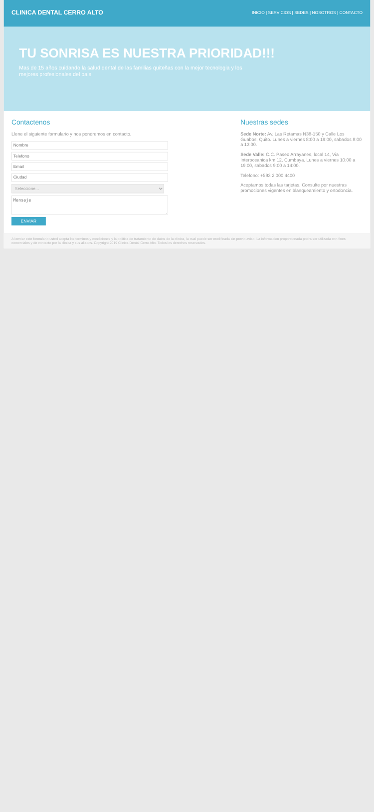
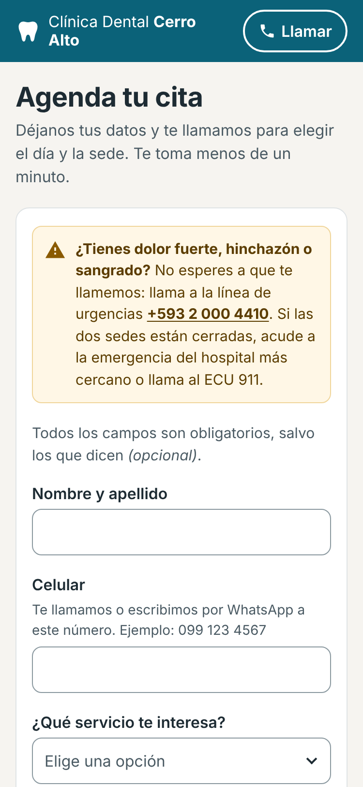
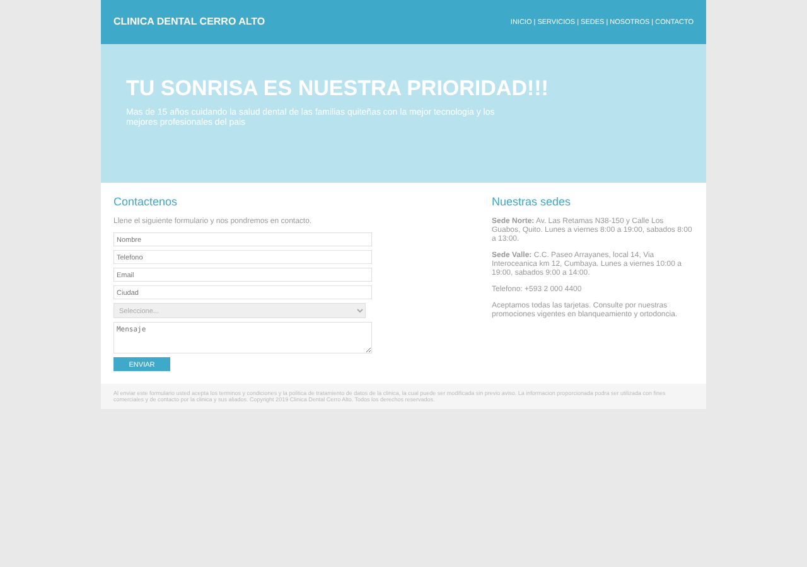
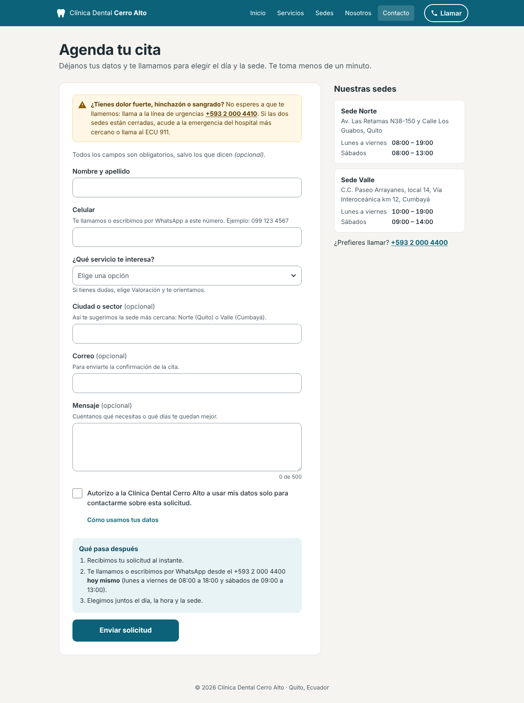
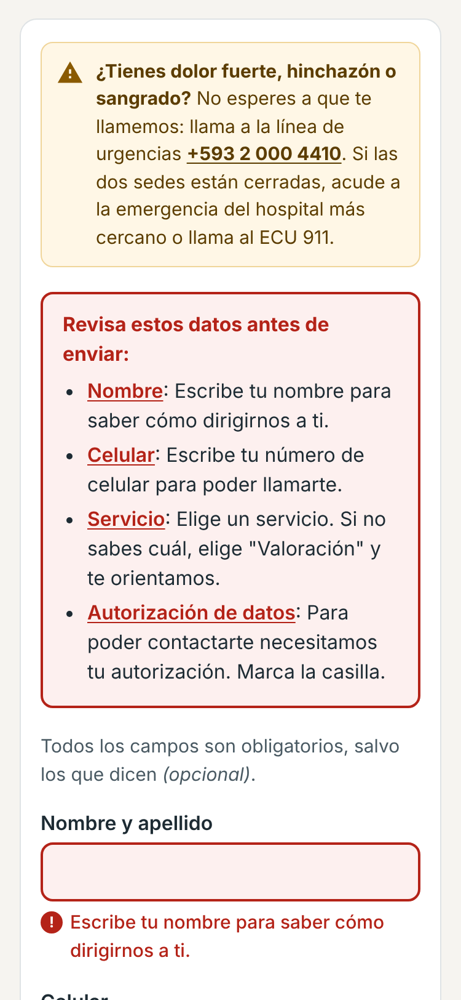
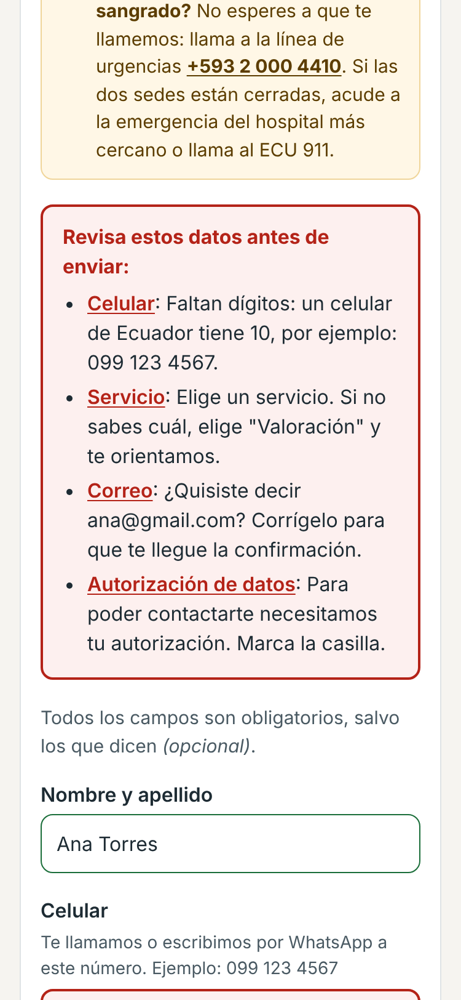
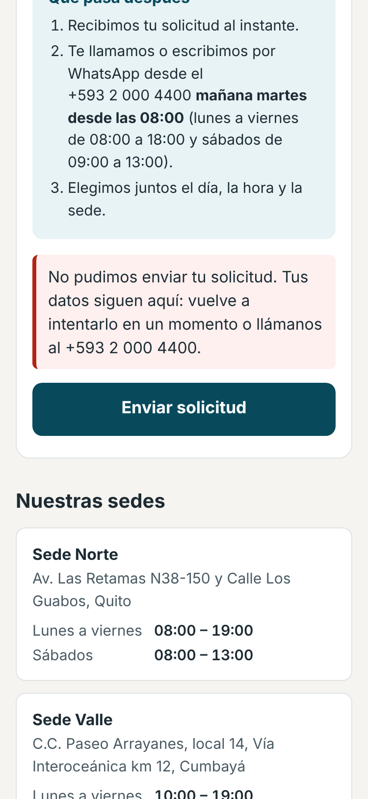
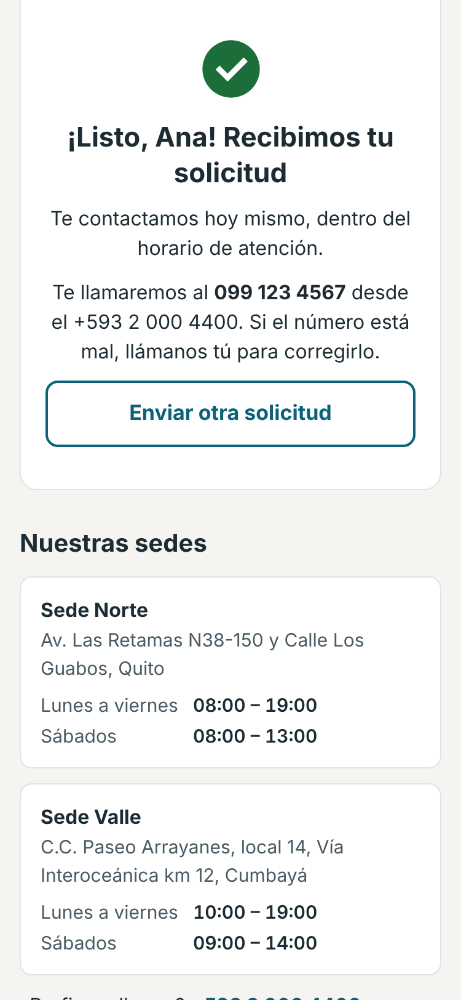

# Formulario de contacto · Clínica Dental Cerro Alto (rediseño)

link: https://jor3nto.github.io/cerro-alto-formulario/ 

Rediseño del formulario web de la clínica para que lleguen **datos válidos** al sistema de leads y para que **se use bien en el celular**. Cada envío sigue generando el mismo evento del conector de Meta, con `source.platform = "web"` y `source.campaign = null`.

> Clínica ficticia, creada para la prueba técnica de INVERS.

## Cómo verlo

- **En línea:** https://jor3nto.github.io/cerro-alto-formulario/ (GitHub Pages de este fork).
- **En local:** abre `index.html` en el navegador. Es HTML, CSS y JavaScript puros, sin instalar nada.
- **Pruebas de las reglas de validación** (Node 18 o superior): `node --test`

Por defecto no envía nada: muestra el evento en la consola del navegador (F12 → Consola). Para enviarlo a un webhook, pon la URL en `config.js`.

## Antes y después

| | Antes | Después |
|---|---|---|
| **Celular (375 px)** |  |  |
| **Escritorio** |  |  |

**Validación y estados en el celular:**

| Enviar vacío | Datos mal escritos | Falla al enviar | Enviado |
|---|---|---|---|
|  |  |  |  |

## Qué encontré y qué cambié

Los ordené por lo que más le cuesta a la clínica: primero los datos inválidos, después el abandono en el celular.

### Datos inválidos

| Problema | Qué cambié |
|---|---|
| **No había ninguna validación.** Lo probé: con todo vacío, el formulario envía un lead sin nombre ni teléfono y con `service_interest: "Seleccione..."`, y dice "Enviado". | Cada campo tiene su regla. Al enviar con errores no sale nada: aparece un resumen arriba con enlaces a cada campo, y cada campo muestra su error debajo. |
| **Teléfono en texto libre.** Pasaban "099 123 45", letras o números de otro formato. | Campo de teléfono (`type="tel"`) que acepta cómo escribe la gente (`099 123 4567`, `+593 99…`, `593…`, fijos `02…`, números de otro país con `+`), valida largo y prefijo de Ecuador y envía el número en formato internacional (`+593991234567`), el mismo que usa el sistema de leads para detectar duplicados. |
| **Correo sin validar.** | Se valida la forma y se detectan errores de dedo comunes (`gmial.com`, `hotmail.con`) con un botón "¿Quisiste decir ana@gmail.com?" que lo corrige de un toque. Se guarda en minúsculas. |
| **"Seleccione..." se enviaba como servicio.** | La opción vacía ya no se puede enviar, y la ayuda dice "si tienes dudas, elige Valoración". |
| **Mensajes de error que no dicen cómo corregir** (no había ninguno). | Cada error dice qué hacer: *"Faltan dígitos: un celular de Ecuador tiene 10, por ejemplo: 099 123 4567"*. |
| **"Enviado" aunque fallara**, y el formulario se borraba igual. El `fetch` no se esperaba y se podía enviar dos veces. | Espera la respuesta. Si falla, **no borra los datos**, explica qué pasó y ofrece el teléfono. El botón se bloquea mientras envía. Si la persona reintenta, se reenvía **el mismo `event_id`**: si el primer intento sí llegó, el sistema de leads lo descarta como duplicado en vez de crear dos. |
| Nombres como "ana torres" o "ANA TORRES". | Se dejan como nombre propio ("Ana Torres") para que recepción lo lea bien en el aviso. |

### Uso en el celular (abandono)

| Problema | Qué cambié |
|---|---|
| **Faltaba la etiqueta `viewport`.** A 375 px el celular dibujaba la página a 981 px y la encogía: letra de unos 5 px y campos imposibles de tocar. | Diseño pensado primero para el celular, en una columna y sin desplazamiento horizontal a 375 px. |
| Letra de 11 px en los campos: el iPhone hace zoom al tocar cada uno. | Letra de 16 px y campos de 48 px de alto. |
| Todos los campos eran `type="text"`: el celular mostraba el teclado de letras para el teléfono y el correo. | Teclado numérico para el teléfono y de correo para el correo, con `autocomplete` para que el celular ofrezca los datos guardados. |
| Un banner de 220 px empujaba el formulario fuera de la primera pantalla. | Título corto ("Agenda tu cita") y el formulario empieza en la primera pantalla. |
| Botón "ENVIAR" de 80 px de ancho. | Botón de ancho completo, de 54 px de alto. |
| Seis campos al mismo nivel. | Solo son obligatorios nombre, celular, servicio y la autorización. Ciudad, correo y mensaje dicen *(opcional)*: cada campo obligatorio de más es gente que abandona, y para llamar basta el celular. |

### Claridad y confianza

| Problema | Qué cambié |
|---|---|
| No decía qué pasa después de enviar ni cuándo responde la clínica. | Bloque "Qué pasa después" junto al botón. El texto se calcula con la hora de Ecuador y el horario de los asesores: "hoy mismo" o, fuera de horario, "mañana martes desde las 08:00" (también salta domingos y feriados). La confirmación repite cuándo y a qué número llamarán. |
| El consentimiento estaba en un pie de página de 9 px gris claro, se daba por aceptado al enviar y decía que los datos se usarían "con fines comerciales por la clínica y sus aliados" y que la política "puede ser modificada sin previo aviso". | Casilla de autorización explícita, con un texto corto: los datos solo se usan para contactar sobre esta solicitud, no se comparten y se pueden corregir o borrar (la Ley Orgánica de Protección de Datos Personales del Ecuador pide consentimiento explícito). **El texto definitivo lo tiene que aprobar la clínica.** |
| Quien tenía dolor o hinchazón solo podía llenar el formulario y esperar. | Aviso de urgencias antes del formulario con la línea +593 2 000 4410 (se puede tocar para llamar), igual que la regla de urgencias del asistente Cami. |
| Texto sin tildes, todo en mayúsculas, "Copyright 2019", promociones sin decir cuáles. | Texto corregido, tono cercano y sin promesas vagas. Los teléfonos se pueden tocar para llamar. |

### Accesibilidad

| Problema | Qué cambié |
|---|---|
| Sin etiquetas: el placeholder hacía de etiqueta y desaparecía al escribir. | Etiquetas visibles en todos los campos y textos de ayuda asociados con `aria-describedby`. |
| Contraste insuficiente: texto blanco sobre azul de marca (2,7:1), texto gris #999 (2,8:1), texto de los campos #aaa (2,3:1), pie de página (1,8:1). | Todo el texto supera 4,5:1. El azul de la marca se oscureció a #0b6279 (6,9:1 con blanco). |
| `outline: none`: con el teclado no se veía dónde estaba el foco. | Foco visible en todo (borde amarillo de 3 px). |
| El botón era un `div` con `onclick`: no se podía enviar con el teclado ni con Enter. | `<button type="submit">`: funciona con Tab, Enter y lectores de pantalla. |
| — | Errores marcados con `aria-invalid`, anunciados con `aria-live` y señalados con borde, ícono y texto (nunca solo con color). Al enviar con errores, el foco va al resumen. Enlace para saltar al formulario e idioma `es-EC`. |

**Cómo lo verifiqué:** con Chromium a 375 px (sin desplazamiento horizontal), con axe-core (0 problemas de WCAG A y AA), recorriendo todo con Tab y Enter, simulando una falla del webhook para revisar que se conservan los datos y se reenvía el mismo `event_id`, y con 6 pruebas automáticas de las reglas (`pruebas/validacion.test.js`).

## El evento que se envía

Mismos campos y formato que el conector de Meta. Los campos opcionales vacíos van como `null`:

```json
{
  "event_id": "evt_web_mvfds2o0kdbnam",
  "event_type": "lead.created",
  "created_at": "2026-10-19T15:00:00.000Z",
  "source": { "platform": "web", "campaign": null, "form_id": "frm_web_contacto" },
  "lead": {
    "full_name": "Ana Torres",
    "phone": "+593991234567",
    "email": "ana@gmail.com",
    "city": "Cumbayá",
    "service_interest": "Valoración",
    "message": "Me duele una muela desde ayer"
  }
}
```

Los valores de `service_interest` son los mismos del formulario original (solo cambió el texto que ve la persona), para que el sistema de leads los siga entendiendo igual.

## Conexión con mi sistema de la Parte A

No lo dejé conectado. El evento ya tiene el formato que espera mi webhook (`POST /webhook`). Para conectarlo bastaría con poner su URL en `config.js` y habilitar CORS en el FastAPI de la Parte A para el dominio del formulario, porque el navegador envía desde otro origen.

## Archivos

- `index.html`: la página.
- `styles.css`: estilos, primero para el celular y después para escritorio.
- `validacion.js`: las reglas de cada campo, separadas para poder probarlas sin navegador.
- `script.js`: validación en pantalla, envío, reintento y confirmación.
- `config.js`: URL del webhook (vacía = solo consola).
- `pruebas/validacion.test.js`: pruebas de las reglas.
- `capturas/`: capturas de antes y después.
